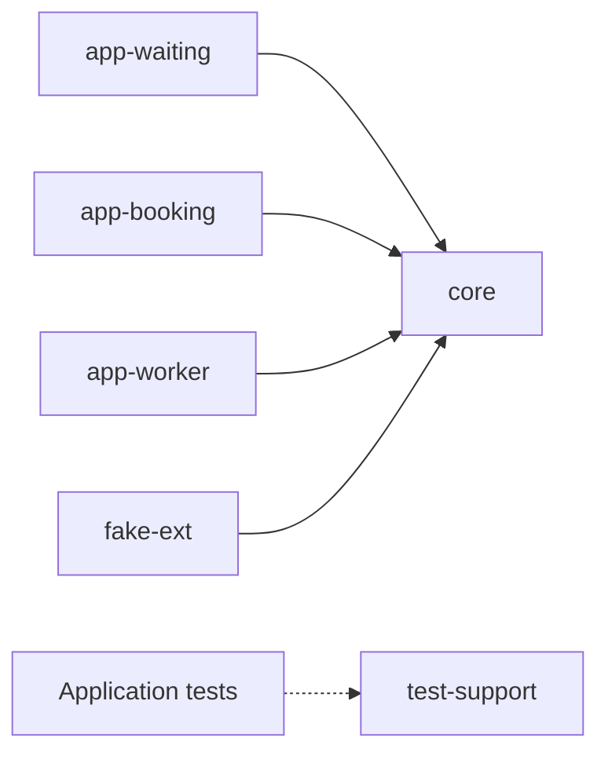

# Architecture

The current system is a Java 21, Spring Boot backend with six Gradle modules. Four modules produce executable applications; `core` and `test-support` are libraries. The modules establish separate processes and testable boundaries before business workflows are added.

## Current modules

| Module | Implemented responsibility | Current limit |
|---|---|---|
| [`core`](../core/) | Configuration validation, masked secret values, shared runtime defaults, MySQL datasource construction | Contains no queue, reservation, payment, or notification logic |
| [`app-waiting`](../app-waiting/) | Application startup, queue Redis configuration, mutually exclusive `api` and `worker` profiles, API-profile secret validation | No queue endpoints, admission decisions, tokens, or scheduled jobs |
| [`app-booking`](../app-booking/) | Application startup, booking Redis and MySQL configuration, Flyway migration | No reservation or payment workflows |
| [`app-worker`](../app-worker/) | Application startup, booking Redis and MySQL configuration, scheduling enabled | No scheduled business jobs; does not run schema migrations |
| [`test-support`](../test-support/) | Testcontainers setup, generated test credentials, startup and configuration assertions, HTTP test helpers | Used by application tests, excluded from application runtime dependencies |
| [`fake-ext`](../tools/fake-ext/) | Application startup and Actuator endpoints | No simulated provider endpoints or fault injection yet |

The diagram shows production code dependencies, not request traffic. Every executable application depends on `core`; none depends on another application module. Application tests separately depend on `test-support`.

These boundaries let a future workflow change within its owning application without introducing direct Java dependencies between applications. The root [architecture test](../src/test/java/lab/ticketing/arch/ArchitectureTest.java) checks cross-application dependencies, reverse dependencies from `core`, and production imports of test support. Negative fixtures verify that the checks can detect violations.

## Data and configuration ownership

The waiting application configures a queue Redis connection. Booking and its worker configure a separate booking Redis connection and MySQL access. Integration tests create distinct Redis containers for those roles. Local runtime configuration must supply distinct endpoints if both roles are run together; both Redis ports default to `6379`.

Booking owns the [Flyway migrations](../app-booking/src/main/resources/db/migration/). The initial table stores a ticket session with capacity and remaining inventory. SQL constraints enforce nonnegative capacity and `0 <= remaining <= capacity`. This protects individual stored values; it does not establish a complete reservation workflow or prove correctness under concurrent requests. The worker does not apply migrations, so booking must initialize a shared database first.

Shared defaults are loaded by `core` with lower precedence than application configuration and explicit environment or command-line settings. They enable virtual threads, graceful shutdown, bounded client/database timeouts, and Actuator health and metrics. Pool sizes and timeout values are starting configuration choices, not measured capacity limits.

## Planned behavior

The [roadmap](roadmap.md) proposes queue admission, conditional inventory updates, uncertain payment outcomes, and an outbox relay. Those mechanisms have no runtime implementation yet. There is also no reverse proxy, multi-service deployment stack, or load generator in this repository.

Each implementation stage should add a focused reproducer and then document the observed result. A future dependency or protocol belongs in this page when its code exists; alternatives and untested assumptions belong in [experiments](experiments/README.md).
